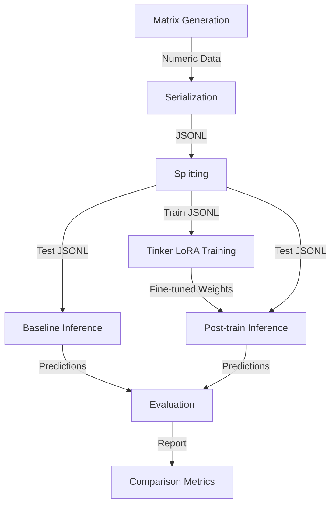

# Architecture Research: MatrixInverse-LLM

## Summary
A linear research pipeline where each stage produces artifacts (JSONL files or metrics) for the next stage.

## Component Boundaries

1.  **Data Generation Layer**: `generate_matrices.py` -> `serialize_dataset.py` -> `build_splits.py`. Creates the ground truth and LLM-ready datasets.
2.  **Infrastructure Layer (Tinker)**: `inference.py` and `train_lora.py`. Encapsulates direct interaction with the Tinker SDK.
3.  **Parsing & Scoring Layer**: `parse_prediction.py` and `score_prediction.py`. Converts text to matrices and computes residuals.
4.  **Orchestration Layer**: `run_experiment.py`. Manages the full lifecycle from baseline through training to final evaluation.

## Data Flow

## Build Order (Dependencies)

1.  **Utilities & Config**: Base logging, IO, and configuration loading.
2.  **Dataset Pipeline**: Must be able to generate and split data before anything else.
3.  **Parsing & Scoring**: Essential for validating the model output format early.
4.  **Inference Client**: Establish baseline communication with Tinker.
5.  **Training Client**: Implement the LoRA loop.
6.  **Experiment Runner**: Combine all modules into a single CLI.

---
*Last updated: 2026-04-28*
